# Agent UI Kit

A template for building **live multi-agent interfaces**: a flow map that shows which agent is working and
which tool it called, a thought stream, sources and charts behind every answer, human approval for risky
actions, saved sessions, light and dark themes, Turkish and English. Clone it, point it at your backend, and
change whatever you like: it is source, not a black box.

```
packages/
  core/    @agent-kit/core    no React. Event protocol, adapters, flow folding, sessions, answer parsing, i18n
  react/   @agent-kit/react   components, hooks, styles. <AgentApp/> is the whole screen
  mock/    @agent-kit/mock    a backend-free server that plays scripted runs (NDJSON, SSE, OpenAI wire format)
apps/
  starter/                    the app you edit: <AgentApp/> wired to an adapter and a kit
docs/                         architecture · protocol · adapters · customizing · theming
```

## Screenshots

| | |
|---|---|
| 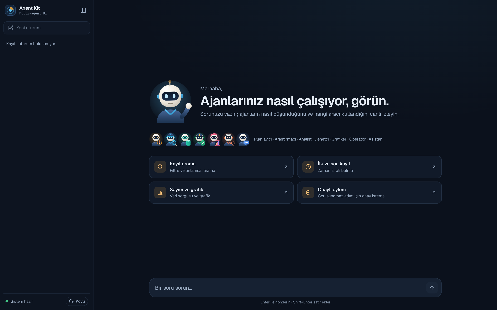 **Home.** The empty screen teaches what can be asked | 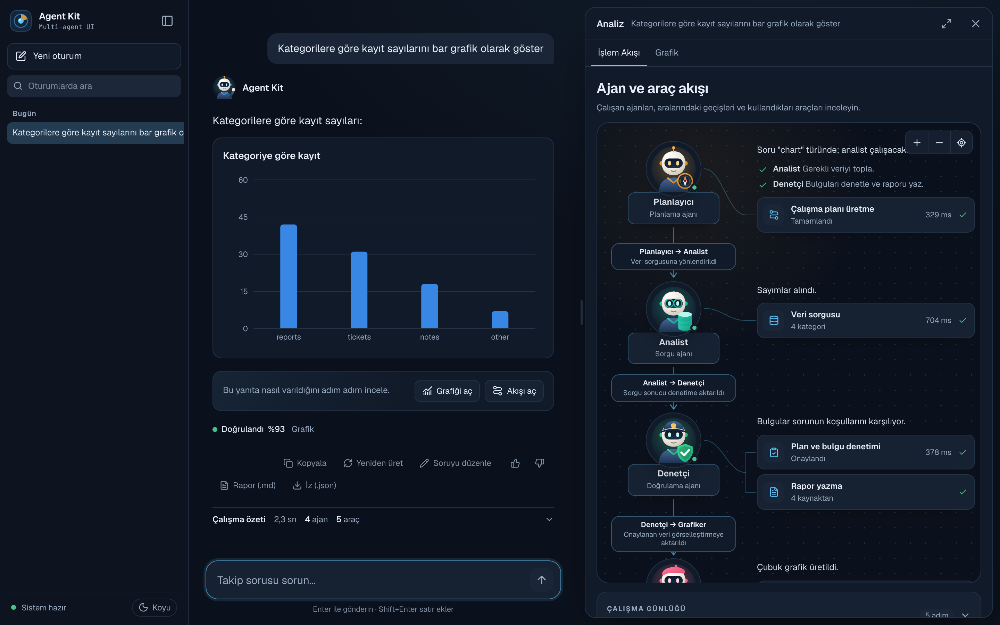 **Answer + live flow map.** Every visit, handoff and tool call |
| 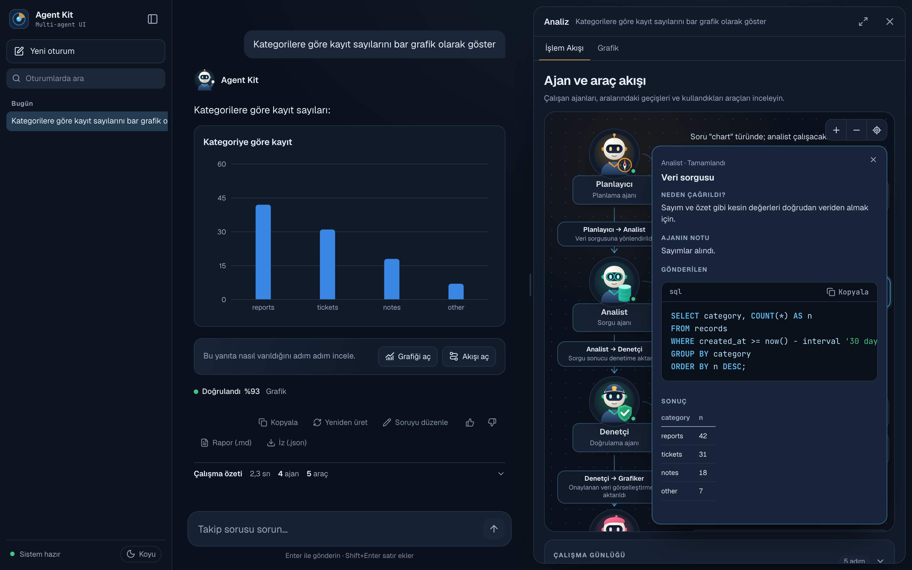 **Step detail.** The query an agent ran and its result | 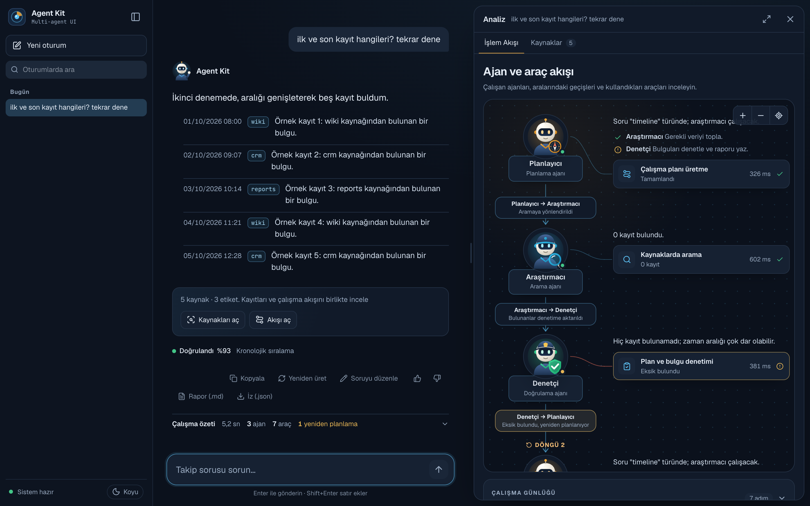 **Replan.** The reviewer sends the work back; pass 2 is drawn below pass 1 |
| 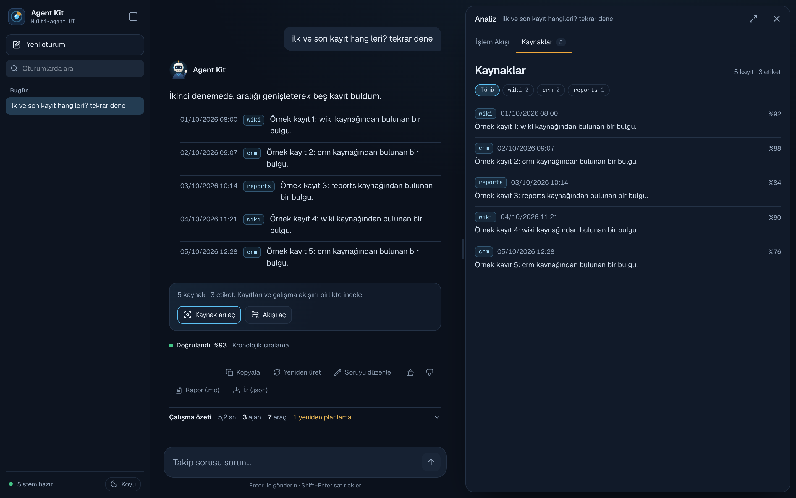 **Sources.** Filter by tag, search, follow a tag from the answer | 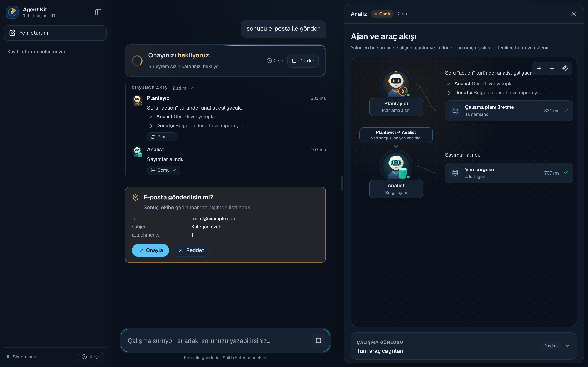 **Human approval.** The run waits for a person before an irreversible step |
| 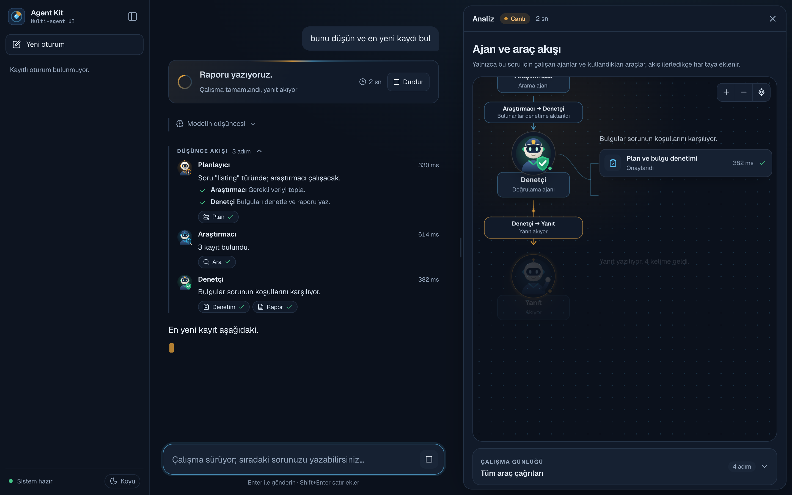 **Reasoning.** Streamed model reasoning in a fold | 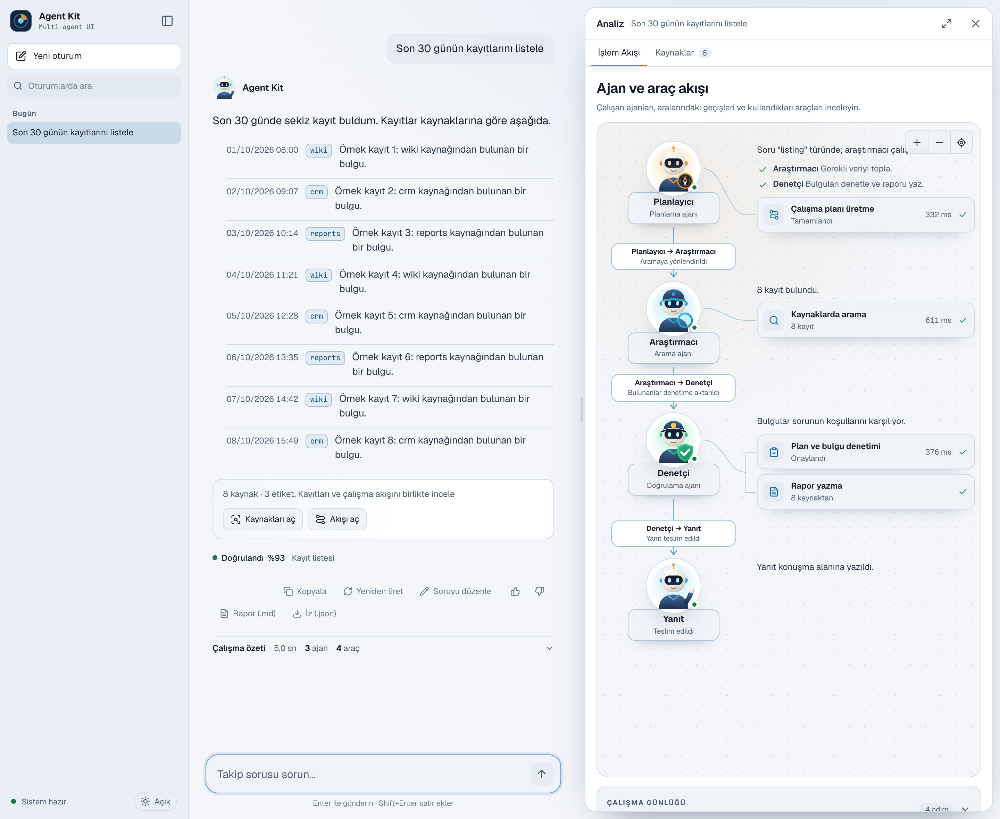 **Light theme.** Same tokens, AA contrast tested |
| 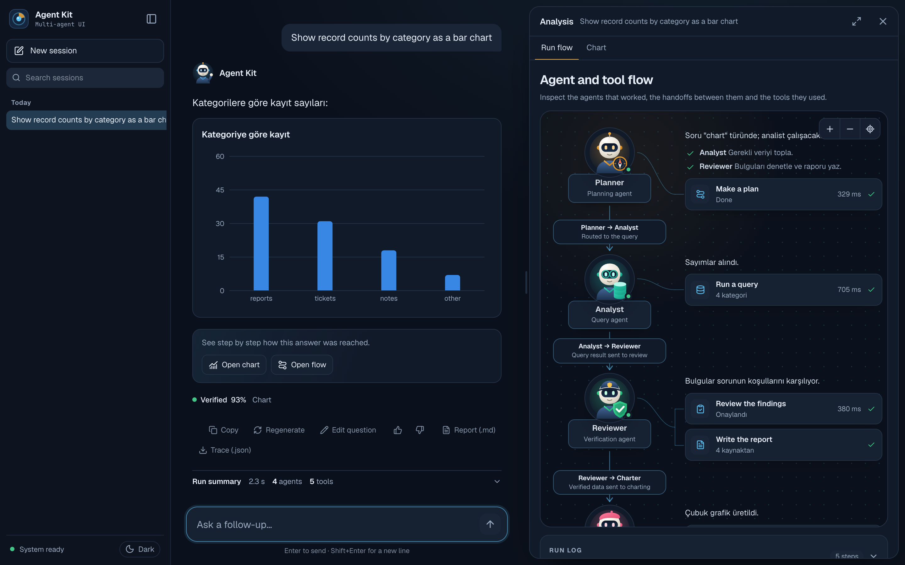 **English.** Turkish is the default, every string is a key | 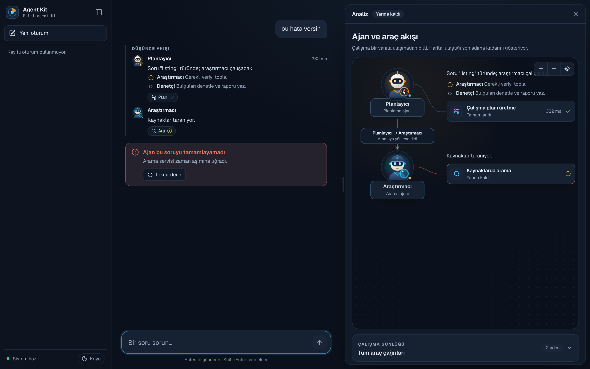 **Error.** The question keeps its place and says what went wrong |
| 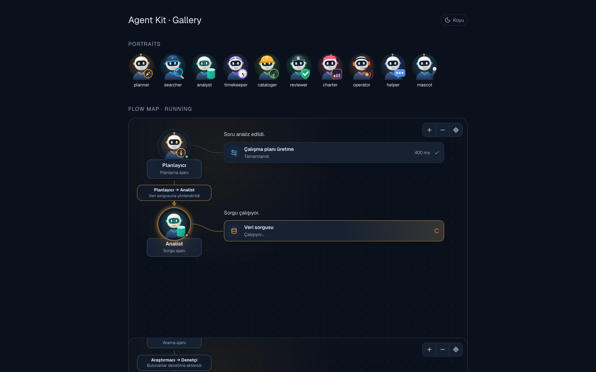 **Gallery.** Every component in every state, no backend | 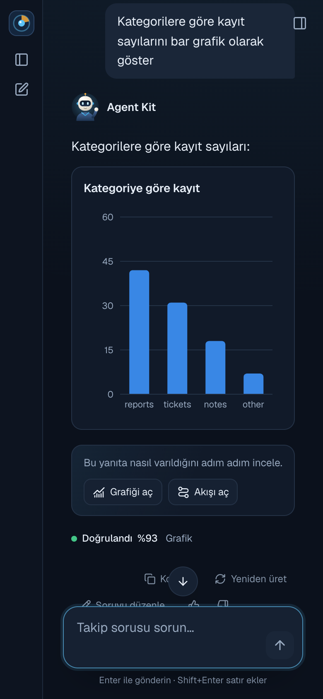 **Phone width.** |

Regenerate them against a running stack: `npm i --no-save playwright-core && node scripts/screenshots.mjs`.

## Run it

With Docker (nothing else to install):

```bash
docker compose up --build            # http://localhost:8080, against the mock backend
```

```bash
docker compose --profile test run --rm check   # typecheck, tests, build and the clean gate, in a container
```

Locally (Node 22+):

```bash
npm install
npm run mock                         # terminal 1: the mock backend on :18100
npm run dev                          # terminal 2: http://localhost:5173
npm run check                        # typecheck, tests, build, clean gate
```

Words in a question pick the scripted run the mock plays: `grafik` (chart), `tekrar` (replan loop),
`e-posta` (asks for approval), `düşün` (streams reasoning), `hata` (error), `kopma` (dropped connection),
`kaç` (query), `merhaba` (chat). `http://localhost:8080/?view=gallery` shows every component in every state
with no backend; `?lang=en` switches the language.

## Use it on your backend

1. **Speak the protocol or write an adapter.** A backend that emits the kit's events as one JSON object per
   line needs no code (`createNdjsonAdapter`). Anything else maps to events in a few lines
   (`docs/adapters.md`): there are adapters for SSE, OpenAI-compatible APIs and LangGraph's `updates` stream.
2. **Describe your team.** `apps/starter/src/kit.ts` names your graph's nodes, tools and categories
   (`docs/customizing.md`). A node the kit does not know still renders, under the title the backend sent.
3. **Pick where sessions live.** This browser (default) or your backend (`createHttpSessionStore`).

```tsx
<AgentApp adapter={createNdjsonAdapter({ baseUrl: "/api" })} kit={myKit} locale="en" />
```

## What is in it

| | |
|---|---|
| Live flow map | Every visit an agent made, handoffs, tools, plan progress. A node that runs twice is two visits, so a replan is visible |
| Thought stream, reasoning | The run told as a story; streamed model reasoning in a fold |
| Sources, charts, code | Panel tabs; answer blocks drawn by a renderer registry you can extend |
| Human approval | `approval.request` shows a card; `adapter.respond()` answers the backend |
| Message actions | Copy, regenerate, edit the question, rate, export the run as Markdown or JSON |
| Sessions | IndexedDB (no backend needed) or HTTP; address-synced so a link reopens the session |
| Themes, i18n | Light, dark, system, from tokens; Turkish (default) and English, every string overridable |
| Accessibility | WCAG AA contrast is a test for both themes; `prefers-reduced-motion` stops every animation; air-gapped: fonts ship in the bundle, no CDN |

## Rules the code keeps

- `fetch` lives in `@agent-kit/core` adapters and stores only. Components never build a URL or parse a response.
- The UI shows only what the backend reported. No timer fakes progress; times are this browser's measurement.
- One palette per theme, in `packages/react/src/styles/tokens.css`. A test fails if text drops below AA.
- Nothing domain-specific lives in the packages (`npm run check` greps for it).

## License

[MIT](LICENSE): use it, change it, ship it, in open or closed projects; keep the copyright notice.

Bundled third-party assets keep their own licenses. The fonts Geist and JetBrains Mono (via `@fontsource`) are
under the SIL Open Font License 1.1, which permits bundling and redistribution with software. The npm
dependencies are installed, not copied into this repository; check `npm ls --all` and their licenses if you
need a full inventory for compliance.
